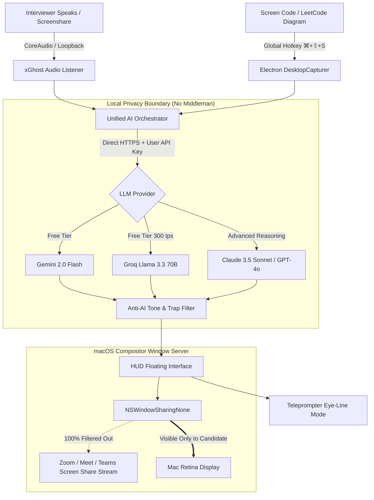

<div align="center">

```
             ____  _               _   
 __  __    / ___|| |__   ___  ___| |_ 
 \ \/ /   | |  _ | '_ \ / _ \/ __| __|
  >  <    | |_| || | | | (_) \__ \ |_ 
 /_/\_\    \____||_| |_|\___/|___/\__|
                                       
```

# 👻 xGhost Copilot

### **The Open-Source, Ultra-Stealth Interview Copilot for macOS & Windows**
*Invisible to Zoom, Meet & Teams screen sharing. Real Senior-level conversational answers. Zero monthly subscriptions.*

[](https://opensource.org/licenses/MIT)
[](https://github.com/your-username/xghost/releases)
[](https://github.com/your-username/xghost/releases)
[](https://xghost.vercel.app)
[](#-the-anti-ai-engine)
[](CONTRIBUTING.md)

[**🌐 Interactive Web Demo**](https://xghost.vercel.app) • [**📦 Download Latest Release**](https://github.com/your-username/xghost/releases) • [**🇷🇺 Документация на русском**](README_RU.md)

</div>

---

> **Why pay $50/month for closed-source interview tools?**
>
> Commercial tools charge exorbitant subscription fees, transmit your private interview audio to unknown third-party servers, and produce generic robotic answers that experienced recruiters spot in seconds.
>
> **xGhost is 100% free, 100% open-source, and 100% local.** Plug in your own free Google Gemini or Groq API key, and interview with total confidence.

---

## ⚡ Key Highlights

### 🛡️ 1. Hardware-Level Stealth Cloak (`NSWindowSharingNone`)
Standard screen recording tools capture everything on your screen. **xGhost bypasses this at the OS window compositor level.**
- Utilizes macOS `setContentProtection(true)` (`CGWindowSharingType.none`).
- While you see a glowing dark OLED HUD hovering over your IDE or browser, **your Zoom, Google Meet, Microsoft Teams, Slack, or Discord screen share streams a completely clean display**.
- The interviewer sees only your code. You see live bullet points, optimal code complexity, and interviewer trap warnings.

### 🗣️ 2. The Anti-AI Engine (No Robotic Textbooks)
Regular LLMs output robotic giveaways:
> *"Certainly! In modern distributed computing architectures, rate limiting represents a paradigm..."* ❌ *(Instantly flagged by interviewers).*

**xGhost formats answers how real Senior Engineers talk:**
- **⚡ 1-Second Punchline**: The first words out of your mouth so you never stall awkwardly.
- **🎙️ 1st-Person War Stories**: Conversational phrasing with authentic engineering trade-offs (*"In our stack we hit this with Redis cluster..."*).
- **🎯 3-Second Bullets**: Scan key points in milliseconds if you prefer improvising.
- **⚠️ Trap Detector**: Predicts what the interviewer will drill you on next to test if you're faking it.

### 👁️ 3. Eye-Contact Teleprompter Mode
Press `⌘ + ⇧ + T` to collapse the HUD into an ultra-thin teleprompter bar positioned **directly under your webcam lens**.
- Read bullet points while looking dead into the camera.
- 100% natural eye contact — no shifting gaze, no second-monitor giveaway.

### 📸 4. Instant Screen OCR & Code Solver (`⌘ + ⇧ + S`)
Facing a LeetCode problem, SQL schema, or system architecture diagram? Tap the hotkey, drag a selection box, and xGhost parses the problem, builds the $O(N)$ solution, and explains space/time complexity in under a second.

### 🔑 5. Bring Your Own Key (BYOK) — Zero Markup
Run unlimited interviews completely free:
- **Google Gemini 2.0 Flash**: Free tier (15 requests/min), sub-500ms latency, native multimodal image reading.
- **Groq Llama 3.3 70B**: Free tier, blazing ~300 tokens/second inference.
- **OpenAI GPT-4o** & **Anthropic Claude 3.5 Sonnet**: Supported natively for complex System Design questions.

---

## 📊 Comparison Matrix

| Feature | 👻 xGhost (Open Source) | GhostGPT ($50/mo) | Standard ChatGPT | Clueless LeetCode Bots |
|:---|:---:|:---:|:---:|:---:|
| **Cost** | **100% Free** | \$50 / month | \$20 / month | \$30–\$80 / mo |
| **Source Code** | **MIT Open Source** | Closed Source | Closed Source | Closed Source |
| **Zoom/Meet Stealth** | ✅ **Hardware Composited** | ✅ Yes | ❌ Visible on screen | ⚠️ Window title rename only |
| **Response Style** | 🧠 **Human Senior Engineer** | ⚠️ Generic LLM | ❌ Textbook AI robotic | ❌ Raw code dump |
| **Webcam Eye Contact** | 👁️ **Teleprompter HUD** | ❌ Floating window | ❌ Separate tab | ❌ No |
| **Privacy & Keys** | 🔒 **Local Storage Only** | ❌ Proxy server | ❌ OpenAI cloud | ❌ Cloud telemetry |
| **Offline Code OCR** | ✅ **Native Hotkey** | ⚠️ Web extension | ❌ Manual upload | ⚠️ Buggy extension |

---

## 🛠️ Architecture



---

## 🚀 Quick Start

### Option A: Pre-built Binaries (Zero Setup)
Download the latest verified release from [**Releases**](https://github.com/your-username/xghost/releases):
- **macOS Apple Silicon (M1/M2/M3/M4)**: `xGhost Copilot-1.0.0-arm64.dmg`
- **Windows (10/11 x64)**: `xGhost Copilot Setup 1.0.0.exe`

1. Launch the app.
2. Click the ⚙️ **Settings** icon.
3. Paste a free key from [Google AI Studio](https://aistudio.google.com/app/apikey) or [Groq Console](https://console.groq.com/keys).
4. You're ready to interview!

### Option B: Run from Source

```bash
# 1. Clone repository
git clone https://github.com/your-username/xghost.git
cd xghost

# 2. Install dependencies
npm install

# 3. Start Electron HUD with Hot Reloading
npm run dev:electron
```

To build production binaries yourself:
```bash
# Package macOS DMG + ZIP (Apple Silicon)
npm run pack:mac

# Package Windows EXE installer
npm run pack:win
```

---

## ⌨️ Global Keyboard Shortcuts

| Shortcut | Description |
|:---|:---|
| `⌘ + ⇧ + Space` | **Toggle HUD Visibility**: Instantly hide/show overlay |
| `⌘ + ⇧ + S` | **Screen Snippet (OCR)**: Capture problem description or code |
| `⌘ + ⇧ + R` | **Toggle Speech Recognition**: Listen to interviewer's question |
| `⌘ + Enter` | **Generate Answer**: Run query against active LLM model |
| `⌘ + ⇧ + T` | **Teleprompter Mode**: Collapse into eye-contact strip under camera |
| `⌘ + ⇧ + ↑ / ↓` | **Adjust Opacity**: Fine-tune HUD transparency (10% to 100%) |
| `⌘ + ⇧ + X` | **Panic Switch**: Emergency silent wipe from screen |

*(On Windows, replace `⌘` with `Ctrl`)*

---

## 🎯 Supported Interview Roles

xGhost includes customized prompt personas that tune vocabulary and focus areas:
- **Frontend / Web**: React 18/19 internals, hydration, layout thrashing, CSS container queries, bundle optimization.
- **Backend / Distributed**: Concurrency models, event loops, database sharding, indexing, idempotent APIs.
- **System Design**: CAP theorem, message brokers (Kafka/RabbitMQ), caching tiers (Redis), high-availability architectures.
- **LeetCode / Algorithms**: Optimal time/space trade-offs, edge cases, corner tests.
- **DevOps / SRE**: Kubernetes pods, Terraform states, zero-downtime canary deploys, eBPF monitoring.
- **Mobile (iOS/Android)**: Memory management, ARC, GC pauses, Swift Concurrency, background workers.

---

## 🤝 Contributing

We welcome community contributions! Please read our [CONTRIBUTING.md](CONTRIBUTING.md) to get started.
- Add support for local LLMs (Ollama, LM Studio).
- Improve prompt templates for niche engineering tracks.
- Optimize audio capture and speech recognition models.

---

## ⚖️ Ethical & Educational Disclaimer

**xGhost Copilot is an educational research tool.** It was built to help developers practice mock interviews, overcome debilitating interview anxiety, and test real-time AI assistive interfaces.

- We do not encourage misrepresenting your technical capabilities.
- Always respect your non-disclosure agreements (NDAs) and employer codes of conduct.
- The authors assume no liability for misuse.

---

## 📄 License

Licensed under the [MIT License](LICENSE). Free for personal and commercial use.

<div align="center">
  <sub>Built with ❤️ by the open-source community for developers everywhere.</sub>
</div>
